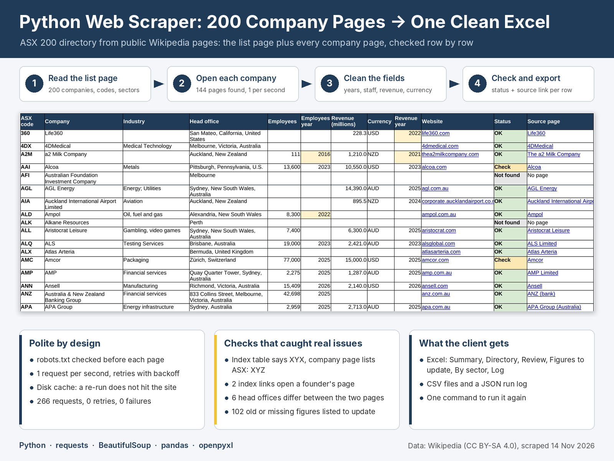
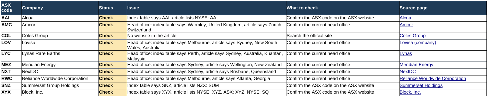
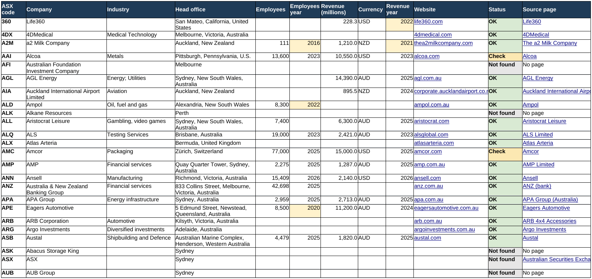

# ASX 200 company directory scraper (Python)



**What it does:** reads the list of the 200 companies in the S&P/ASX 200 index on Wikipedia, opens the page of every company and builds one clean Excel directory: industry, head office, founding year, employees, revenue (with currency and year), website and market cap, plus a **status** and a **source link** on every row.

It is the classic scraping job "go through this list and open every listing": list page, detail pages, clean table. It is done politely, and the checks tell you which rows you can trust and which ones need a look.

## Results (run of 14 Nov 2026)

| | |
|---|---|
| Companies in the index table | 200 |
| Company pages read | 144 (140 links in the table plus 7 pages found by name, minus 3 links that open a page without a company infobox) |
| Status OK / Check / Not found | 134 / 10 / 56 |
| Fields filled | website 143, industry 135, founded 143, employees 100, revenue 104 |
| Figures to update (missing, undated or 3+ years old) | 102 rows, listed in their own tab |
| Pages requested | 266 at 1 per second: 160 pages, 106 "no such page" answers from the name search, 0 retries, 0 failures, 5 min |

## What the checks caught

- **Block, Inc.**: the index table says `XYX`, the company page lists `ASX: XYZ`.
- **Alcoa** (`AAI`) and **Summerset** (`SNZ`): the company page only shows the home exchange code (`NYSE: AA`, `NZX: SUM`), so the code needs a manual check.
- **Premier Investments** and **WiseTech Global**: the link in the index table opens a page about a person (the founder), not the company.
- **6 head offices** differ between the index table and the company page, for example NextDC: Sydney vs Brisbane.
- Suburbs are not flagged: "Sydney" vs "Alexandria, New South Wales" is the same state.
- A bare `$` in revenue is read as A$ only when the head office is in Australia, and the row says so.



## Output

- `ASX200_Company_Directory.xlsx`
  - **Summary**: totals and field coverage as live formulas, run details, legend
  - **Directory**: one row per company, status colours, amber years when a figure is 3+ years old
  - **Review**: the 10 rows to check and the 56 companies with no company page, with what to check
  - **Figures to update**: employee and revenue figures that are missing, undated or old
  - **By sector**: companies, statuses, websites and market cap per sector (formulas)
  - **Log**: requests, answers, retries and issue counts
- `out/asx200_directory.csv`, `out/review.csv`, `out/figures_to_update.csv`
- `out/scrape_log.json`: requests, status codes, retries, timing and coverage



## How it works

1. Downloads the S&P/ASX 200 page and reads the constituents table: code, company, sector, market cap, head office and the link to the company page.
2. Opens every linked page. When there is no link, or the link opens the wrong kind of page, it tries the company name as a page title and keeps the page only if its infobox lists the same code.
3. Reads the company infobox: type, traded as, industry, founded, head office, employees, revenue and website. People fields (founders, key people) are skipped.
4. Cleans the values: the year from a founding date, head counts such as `5,000+ (2019)`, revenue such as `NZ$ 2,188M (2022)` to millions with currency and year, and the website domain.
5. Checks every row (head office state or country, same code on both pages, links that open a person's page, old figures) and writes the CSV files, the log and the workbook.

## Polite scraping

- `robots.txt` is checked before any page is downloaded (`urllib.robotparser`).
- The User-Agent includes a contact URL, as the site's policy asks.
- 1 request per second, with retries and exponential backoff on 429 and 5xx (honours `Retry-After`).
- Every answer is cached on disk, 404s included, so a re-run does not hit the site again.
- Public pages only, no logins, no personal data.

## Run it

```bash
pip install -r requirements.txt
python scrape_asx200.py      # about 5 minutes the first time, seconds after that (cache)
python build_xlsx.py         # writes ASX200_Company_Directory.xlsx
```

Use `--delay 2` for a slower crawl or `--refresh` to download every page again.

## Data source and licence

Text and data come from Wikipedia: the [S&P/ASX 200](https://en.wikipedia.org/wiki/S%26P/ASX_200) page and each company article, under [CC BY-SA 4.0](https://creativecommons.org/licenses/by-sa/4.0/). The files in `out/` and the workbook are shared under the same licence. Index membership and company figures change over time, so confirm figures in annual reports before using them. Not affiliated with S&P Dow Jones Indices or ASX.
